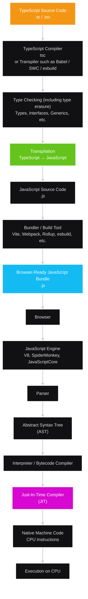

## About

This is [part 9 of the fullstack open course](https://fullstackopen.com/en/part9) by <https://studies.cs.helsinki.fi>

[New Course Platform for Typescript](https://courses.mooc.fi/org/uh-cs/courses/full-stack-open-typescript/)

### Github Actions Test Status

Branches `chapter-2` do not have triggered tests through GitHub workflow actions. There is no `chapter-1` branch.

<!-- <details>
<summary> chapter-4 </summary>

</details>
<br/> -->

## Chapter 2 | Background and Introduction

This chapter provides an overview of Typescript.

### What is [Typescript](https://www.typescriptlang.org/)?

- Typed superset of JavaScript.
- Can be compiled into Javascript standard ECMAScript 3 or newer.
- **All existing Javascript code is valid Typescript**.

### What is Typescript for?

- Designed for large Javascript development.
- Has development-time tooling, static code analysis, compile-time type checking and code-level documentation.



> Browsers understand standardized JavaScript, not TypeScript. TypeScript exists primarily as a development-time language and type system layered on top of JavaScript.

#### What is the Just-In-Time Compiler?

A Just-in-Time (JIT) compiler converts Javascript into native machine code while the program is running.

The Central Processing Unit (CPU) cannot execute JavaScript source code directly. The JavaScript engine first analyzes the code, then the Just-in-Time (JIT) compiler can optimize frequently executed code and turn it into fast machine instructions.

### Key Language Features

#### Type Annotations

Enforces the behavior of a function or variable.

A function that returns a string:

```typescript
const hello = (name: string): string => {
  return `Hello ${name}!`;
};

console.log(hello("world"));
```

Similarly like Javascript, semi-colons `;` are optional as Typescript follows Javascript rules for Automatic Semicolon Insertion (ASI).

> However, many codebases still use semicolons consistently because they can prevent edge cases where Automatic Semicolon Insertion (ASI) interprets adjacent lines unexpectedly.

#### Keywords

TypeScript inherits all the reserved keywords from JavaScript.It also has its own type-related keywords like `interface`, `type`, `enum`, `implements`, `declare`.

#### Structural Typing

Typescript decides whether two values are compatible based on their shape—that is, the properties and methods they have—rather than requiring them to share the same explicitly declared type name.

For example:

```typescript
class Dog {
  name: string;
}

class Cat {
  name: string;
}

// Can be used interchangeably
let dog: Dog = new Cat();
```

Structural typing is NOT by type name.

#### Type Inference

Inferring a type when the type has not be explicitly given. It can determine a type based on contextual typing such as where a value is being used. This occurs during compile-time type analysis.

#### Type Erasure

**No type information remains at runtime**.

The lack of runtime type information can be surprising for programmers who are used to extensively using _reflection_ or other metadata systems.

Languages such as Java and C# provide substantial runtime _reflection_ facilities. A framework can inspect a class and discover information about it dynamically.

Metadata is essentially extra information attached to program elements that survives into runtime, or is otherwise made available to runtime code.Because TypeScript erases types, frameworks sometimes need another way to preserve information they care about.

### Why use Typescript?

- Type checking and static code analysis can reduce runtime errors, and reduce the number of unit tests. It safeguards against typos and doing something out of scope.
- Code-level documentation makes it easier to work on existing code as the a function signature can provide the types of data is can return.
- Types can be reused.
- IDEs can provide specific and smarter code hints or suggestions.
- Makes refactoring code easier do.
- Allows adoption of latest Javascript feature early.

### What Typescript cannot do?

- Checks types only at compile time; runtime errors can still occur.
- External data, such as network responses, is a common source of runtime type mismatches.
- Third-party libraries may have missing, incomplete, or incorrect type declarations.
- [DefinitelyTyped](https://github.com/DefinitelyTyped/DefinitelyTyped) is a common source for community-maintained TypeScript declaration files.
- Type inference is strong but not perfect; sometimes the compiler needs additional guidance.
- Type assertions and type guards can help, but incorrect assertions can hide real problems.
- Complex TypeScript types can produce difficult error messages.

> For long TypeScript errors, the most useful detail is often near the end.

## Chapter 3

Development in Typescript with Express and React.

### Setup

1. Install support to allow Node.js to make use of type checking, compilation, and richer tooling. This package provides the Typescript Compiler (TSC).

```bash
npm install --save-dev typescript
```

Reason: Node.js removes type annotations and relies on remaining Javascript.

1. Use `script` in `package.json` to type check Typescript code.

```json
{
  // treat files in this package as ES modules (ESM) rather than CommonJS modules
  "type": "module",
  // use import/export syntax instead of require
  "scripts": {
    "tsc": "tsc --noEmit"
  },
  "devDependencies": {
    "typescript": "^5.9.3"
  }
}
```

See `chapter-3/package.json`.

To validate type checking on a file:

```bash
npm run tsc file.ts
```

`--noEmit` flag instructs compiler to not generate Javascript output.

1. Configure `tsconfig.json`:

```json
{
  "compilerOptions": {
    "noImplicitAny": false,
    "noEmit": true
  }
}
```

A file to instruct the Typescript compiler how to interpret code, i.e., [how it should work, which files to consume and ignore, and more](https://www.typescriptlang.org/docs/handbook/tsconfig-json.html).

[`noImplicitAny`](https://www.typescriptlang.org/tsconfig#noImplicitAny) - set to `false` to not enforce all variables to require type.

1. Remove `--noEmit` from the line `"tsc": "tsc --noEmit"` in `package.json` to reduce redundancy since it is also set in `tsconfig.json`.

### Custom Types

Illustrated in `chapter-3/multiplier.ts`.

### Type Narrowing

The type for `error` in the try-catch block i.e. `catch (error) {}` is the type `unknown`.

`unknown` is a type-safe counterpart for the type `any`.

Anything can be assigned as `unknown`. However, `unknown` can only be assigned to the same type `unknown`.

[`unknown`](https://www.typescriptlang.org/docs/handbook/2/functions.html#unknown) can be assigned to the type `any` if and only if there is no type assertion or a control flow-based type narrowing.

Type narrowing for error can be done with the `instanceOf` keyword:

```typescript
catch (error: unknown) {
  let errorMessage = 'Something went wrong: '
  // here we can not use error.message
  if (error instanceof Error) {
   // the type is narrowed and we can refer to error.message
    errorMessage += error.message;
```

A good use case for the type `unknown` is using it to receive data and then verifying the type later.

### Command Line Arguments

Requires this package installed:

```bash
npm install --save-dev @types/node
```

Then add `"types": ["node"]` to `tsconfig.json`:

```json
{
  "compilerOptions": {
    "noImplicitAny": false,
    "noEmit": true,
    "types": ["node"]
  }
}
```

Command line arguments can now be access through `process.argv`.

#### To Only have a Block of Code Execute when Called from the Command Line

Use the following

```javascript
if (process.argv[1] === import.meta.filename) {
  // this code block does not execute if the module is exported (i.e. imported by another file)
}
```

### What is the `@types/{npm-package}` library?

Typescript expects code to be typed, including external libraries.

However, many library code is not typed.

[DefinitelyTyped](https://github.com/DefinitelyTyped/DefinitelyTyped) is a community-maintained catalogue of helper libraries to offer typed code for different packages under the `@types/` organization.

It is redundant to install an `@types/` package if the package needed already has type support for Typescript.

> Check the package’s documentation or `package.jso`n for a `types` field.
>
> Install `@types/` packages as `devDependencies`, since is it only needed during development and build
>
> Makes sure to keep their versions aligned with the dependent library to avoid mismatches.

Libraries that lack type support:

- `@types/react`
- `@types/lodash`
- `@types/mongoose`
- `@types/express`

### Typescript Interface

TypeScript's [Interface](https://www.typescriptlang.org/docs/handbook/2/everyday-types.html#interfaces) can be used to create objects with custom attributes.

### Typescript Arrays

[Arrays](https://www.typescriptlang.org/docs/handbook/2/everyday-types.html#arrays) can be declared in the following manner:

```typescript
let values: number[];
```

Or,

```typescript
let values: Array<number>;
```

Eslint's [array-simple](https://typescript-eslint.io/rules/array-type/#array-simple) rule enforces using the `[]` syntax for simple arrays while using `<>` generics syntax for non primitive types.

Correct [suggestions](https://typescript-eslint.io/rules/array-type/#array-simple) by Eslint:

```typescript
const a: Array<string | number> = ["a", "b"];
const b: Array<{ prop: string }> = [{ prop: "a" }];
const c: Array<() => void> = [() => {}];
const d: MyType[] = ["a", "b"];
const e: string[] = ["a", "b"];
const f: readonly string[] = ["a", "b"];
```

### Typescript Compiler Options

Details of [compiler options](https://www.typescriptlang.org/tsconfig/).

The following is a basic declaration of compiler options to develop with Express:

```json
{
  "compilerOptions": {
    "target": "esnext",
    "noEmit": true,
    "noUnusedLocals": true,
    "noUnusedParameters": true,
    "noImplicitReturns": true,
    "noFallthroughCasesInSwitch": true,
    "module": "nodenext",
    "esModuleInterop": true,
    "allowImportingTsExtensions": true
  }
}
```

This option sets the compiler to have any unused parameters:

`"noUnusedParameters": true,`

However there are cases when there are library-wide predefined functions that require declaring a variable even if it's not used at all.

Prefix the unused parameter with an `_` underscore to inform the compiler that it can be ignored.

For example:

```typescript
app.get("/ping", (_req, res) => {
  res.send("pong");
});
```

### Typescript with Express Setup

Install the following:

```bash
npm install express

npm install --save-dev @types/express

npm install --save-dev concurrently
```

Set `package.json` to have the following script definitions:

```json
  "scripts": {
    "tsc": "tsc",
    "start": "node index.ts",
    "dev": "concurrently \"tsc --watch\" \"node --watch index.ts\""
  },
```

[Concurrently](https://www.npmjs.com/package/concurrently) allows running type checking and Node in watch mode at the same time.

`npm start` assumes type checking is done before code is executed.

`npm run dev` allows auto-reloading for the development. The app will continue to run even if type errors occur, so pay attention to the console output.

#### Development with Type Checking

The current trend relies on the editor for type checking while writing code, and run tsc --noEmit in a [continuous integration](https://courses.mooc.fi/org/uh-cs/courses/full-stack-open-continuous-integration) pipeline or as a Git [pre-commit](https://pre-commit.com/) hook.

This keeps the dev loop lightweight.

`node --watch src/index.ts` runs code on save, while the editor surfaces type errors in real time.

Type safety is still enforced, just at the moment that matter rather than blocking every run.

### Express Path versus Query Parameters

#### Path Parameters

Uses `/:`.

For example:

```javascript
// Usage /bmi/180/72
app.get("/bmi/:height/:weight", (req: Request, res: Response) => {
  const height: number = Number(req.params.height);
  const weight: number = Number(req.params.weight);

```

#### Query Parameters

Use `?`.

For example:

```javascript
// Usage: /bmi?height=180&weight=72
app.get("/bmi", (req: Request, res: Response) => {
  const height = Number(req.query.height);
  const weight = Number(req.query.weight);
```

### Default Type in Typescript

Variables with unspecified types will be given the [type `any`](https://www.typescriptlang.org/docs/handbook/2/everyday-types.html#any). In other words, variables are implicitly the type `any` until explicitly given a type.

#### Development Setup to Prevent Usage of the Type `any`

Use the compiler option [`noImplicitAny`](https://www.typescriptlang.org/tsconfig#noImplicitAny) to enforce no usage of the type `any` unless explicitly given the type any (which is usually a rare situation).

ESlint can also help enforce no _explicit_ use of the type `any`, install with:

```bash
npm install --save-dev eslint @eslint/js typescript-eslint
```

Installation require to use the option `--legacy-peer-deps` until a newer version of ESlint is compatible with Typescript 6.

Install ESLin Style plugin:

```bash
npm install --save-dev @stylistic/eslint-plugin
```

Use the following `eslint.config.mjs` to [disallow explicit use of the type `any`](https://github.com/typescript-eslint/typescript-eslint/blob/main/packages/eslint-plugin/docs/rules/no-explicit-any.mdx):

```javascript
import eslint from "@eslint/js";
import { defineConfig } from "eslint/config";
import tseslint from "typescript-eslint";
import stylistic from "@stylistic/eslint-plugin";

export default defineConfig({
  files: ["**/*.ts"],
  extends: [
    eslint.configs.recommended,
    ...tseslint.configs.recommendedTypeChecked,
  ],
  languageOptions: {
    parserOptions: {
      project: true,
      tsconfigRootDir: import.meta.dirname,
    },
  },
  plugins: {
    "@stylistic": stylistic,
  },
  rules: {
    "@stylistic/semi": "error",
    "@typescript-eslint/no-unsafe-assignment": "error",
    "@typescript-eslint/no-explicit-any": "error",
    "@typescript-eslint/explicit-function-return-type": "off",
    "@typescript-eslint/explicit-module-boundary-types": "off",
    "@typescript-eslint/restrict-template-expressions": "off",
    "@typescript-eslint/restrict-plus-operands": "off",
    "@typescript-eslint/no-unused-vars": ["error", { argsIgnorePattern: "^_" }],
  },
});
```

And also configure `package.json` to add a script to run ESlint:

```json
{
  // ...
  "scripts": {
    "tsc": "tsc",
    "calculate": "tsc && node calculator.ts",
    "multiply": "tsc && node multiplier.ts",
    "start": "node index.ts",
    "dev": "concurrently \"tsc --watch\" \"node --watch index.ts\"",
    "lint": "eslint ."
    //  ...
  }
  // ...
}
```

> VSCode may occasionally show type or style related warnings despite having fixed the code. If this occurs, restart the editor. To verify code correctness, run the commands `npm run tsc` and `npm run lint`.
>
> It may be required to restart the ESLint extension to apply the rules defined in the `eslint.config.mjs`.

### Using Typescript 7 for Compilation and Typescript 6 for ESLint in the Same Project

Install Typescript 6:

```bash
npm install --save-dev 'typescript@npm:@typescript/typescript6@^6.0.2'
```

Install Typescript 7::

```bash
npm install --save-dev '@typescript/native@npm:typescript@^7.0.2'
```

Configure `package.json` to have the following defined. `tsc` uses Typescript 7 while ESLint will use "typescript", i.e. Typescript 6, to execute by default.

```json
{
  "scripts": {
    "tsc": "node ./node_modules/@typescript/native/bin/tsc",
    "lint": "eslint ."
  },
  "devDependencies": {
    "@typescript/native": "npm:typescript@^7.0.2",
    "typescript": "npm:@typescript/typescript6@^6.0.2"
  }
}
```

### Type Assertion

[Asserting types](https://www.typescriptlang.org/docs/handbook/2/everyday-types.html#type-assertions) informs the Typescript compiler the type for variables.

Typescript types are removed at runtime, so ype-only imports must be explicitly stated with the keyword `type`. For example, `import { calculator, type Operation } from './calculator';`.

> Note that if the asserted type does not have the type appropriate value, this will result in a runtime error!
> Always validate received data, especially user input.

Never use type assertion unless there is no other way to proceed.

This approach does not use the full power of Typescript but relies on the coder to secure the code.

## Chapter 4

⚠️ The Typescript code used in these chapters are not compiled into Javascript due to the `noEmit`set to `true` compiler option.

`npm run tsc` checks types but does not produce Javascript.

> Node is handling Typescript code at runtime.

### Basic TypeScript Express Project Setup

Install commands:

```bash
npm install typescript --save-dev
```

```bash
npm install express
```

```bash
npm install --save-dev eslint @eslint/js typescript-eslint @stylistic/eslint-plugin @types/express
```

```bash
npm install --save-dev concurrently
```

#### Typescript Config For Express Development

This command is used to initialize a `tsconfig.json`:

```bash
 npm run tsc -- --init
```

> Note that `run tsc` before the `--` flag are arguments for the `npm` command. While arguments after `--` such as `--init` are arguments used by the `tsc` script.

A sample of options used in `tsconfig.json`:

```json
{
  "compilerOptions": {
    "target": "esnext",
    "noEmit": true,
    "module": "nodenext",
    "esModuleInterop": true,
    "allowImportingTsExtensions": true,
    "strict": true,
    "noUnusedLocals": true,
    "noUnusedParameters": true,
    "noImplicitReturns": true,
    "noFallthroughCasesInSwitch": true
  }
}
```

- `esnext` - compile to the latest JavaScript features.
- `nodenext` - use Node.js native module resolution for ES Modules (ESM), i.e., use _import_ syntax instead of require.
- [`esModuleInterop`](https://www.staging-typescript.org/tsconfig#esModuleInterop) - enables compatibility between CommonJS and ESM module styles. Without this requires writing `import * as express from 'express'`.
- `allowImportingTsExtensions` - enables importing Typescript files directly. This is necessary when code is executed with Node.js.

- [`"strict" : true`](https://www.staging-typescript.org/tsconfig#strict) enables the following options:
  - `noImplicitAny`
  - `noImplicitThis`
  - `alwaysStrict`
  - `strictBindCallApply`
  - `strictNullChecks`
  - `strictFunctionTypes`
  - `strictPropertyInitialization`

#### ESLint Configuration for Typescript

See [`/flightdiaries/backend/eslint.config.mjs`](flightdiaries/backend/eslint.config.mjs) for an example config.

### Node.js `--experimental-transform-types` Option

Node's built-in TypeScript support strips types by removing type annotations and runs the remaining Javascript.

`--experimental-transform-types` enables Node.js to handle Typescript features beyond type annotations and those that require actual code transformation.

```json
{
  // ...
  "scripts": {
    "tsc": "tsc",
    "dev": "concurrently \"tsc --watch\" \"node --watch --experimental-transform-types src/index.ts\"",
    "start": "node --experimental-transform-types  src/index.ts"
  }
}
```

The example above is taken from [`/flightdiaries/backend/package.json`](flightdiaries/backend/package.json).

`--experimental-transform-types` is considered an experimental option and its behavior may change in later Node versions. The warnings can be silenced using `--disable-warning=ExperimentalWarning`.

### Importing Other than Code (i.e. JSON Data) as a Module

Suppose JSON data is in a file named `entries.json`:

```json
[
  {
    "id": 1,
    "test": "test1"
  },
  {
    "id": 2,
    "test": "test2"
  }
]
```

Use this import syntax to import as an ESModule:

```javascript
import entries from "../data/entries.json" with { type: "json" };
```

### Type Only Imports

An example of a [type import](https://www.typescriptlang.org/docs/handbook/release-notes/typescript-3-8.html#type-only-imports-and-export):

```typescript
import type { SomeType } from "../types.ts";
```

Typescript's type information is stripped at runtime when ran directly with Node.js.

Javascript's runtime will fail when it attempts to resolve type definitions such as interfaces or type alias if not explicitly stated as types.

Using import type tells both the TypeScript compiler and the runtime transform that this import exists purely for type-checking and should be erased before execution.

A ESLint rule such as [consistent-type-imports](https://typescript-eslint.io/rules/consistent-type-imports/) can pick out type import omissions in code.

```json
  rules: {
    // ...
    "@typescript-eslint/consistent-type-imports": "error",
  },
```

### Request and Response Types

```typescript
Response<any, Record<string, any>, number>;
```

`Response` and `Request` are [generic type](https://www.typescriptlang.org/docs/handbook/2/generics.html#generic-types).

```typescript
interface Response<
  ResBody = any,
  Locals extends Record<string, any> = Record<string, any>,
> extends core.Response<ResBody, Locals> {}
```

```typescript
export interface Request<
    P = ParamsDictionary,
    ResBody = any,
    ReqBody = any,
    ReqQuery = ParsedQs,
    LocalsObj extends Record<string, any> = Record<string, any>,
> extends http.IncomingMessage, Express.Request { //...
```

### Custom Type Guards

A [type guard](https://www.typescriptlang.org/docs/handbook/2/narrowing.html#using-type-predicates) is a function that returns a type predicate. It offers more direction control, it is considered a kind of [Type Narrowing](https://www.typescriptlang.org/docs/handbook/2/narrowing.html).

For example:

```typescript
function isFish(pet: Fish | Bird): pet is Fish {
  return (pet as Fish).swim !== undefined;
}
```

`pet is Fish` is our type predicate in this example.

A predicate takes the form "`parameterName` is Type", where `parameterName` must be the name of a parameter from the current function signature.

Any time `isFish` is called with some variable, TypeScript will narrow that variable to that specific type if the original type is compatible.

Using `isFish` function:

```typescript
// Both calls to 'swim' and 'fly' are now okay.
let pet = getSmallPet();

if (isFish(pet)) {
  pet.swim();
} else {
  pet.fly();
}
```

This example determines if the `text` is a primitive string or a String object.

```typescript
const isString = (text: unknown): text is string => {
  return typeof text === "string" || text instanceof String;
};
```

```typescript
const a = "I'm a string primitive";
const b = new String("I'm a String Object");
typeof a; // returns 'string'
typeof b; // returns 'object'
a instanceof String; // returns false
b instanceof String; // returns true
```

### `const` Object

Is similar to a Typescript `enum` construct.

Setting a variable `as const` gives it `readonly` properties.

```typescript
// Type '"hello"'
let x = "hello" as const;
// Type 'readonly [10, 20]'
let y = [10, 20] as const;
// Type '{ readonly text: "hello" }'
let z = { text: "hello" } as const;
```

[Reference](https://www.typescriptlang.org/docs/handbook/release-notes/typescript-3-4.html#const-assertions) for the above code snippet.

The example below is the enum-like pattern in plain Javascript in lieu of using Typescript's [enum](https://www.typescriptlang.org/docs/handbook/enums.html) construct:

```typescript
export const WeatherConditions = {
  Sunny: "sunny",
  Rainy: "rainy",
  Cloudy: "cloudy",
  Stormy: "stormy",
  Windy: "windy",
} as const;

export type Weather =
  (typeof WeatherConditions)[keyof typeof WeatherConditions];
```

- `typeof` - provides the type of an object.
- `keyof typeof WeatherConditions` - extracts all keys from the object whose type is `WeatherConditions` as a union e.g. `'Sunny' | 'Rainy' | 'Cloudy' | 'Stormy' | 'Windy'`.
- `typeof WeatherConditions[ ]` - looks up the value of the keys and unions them e.g. `'sunny' | 'rainy' | 'cloudy' | 'stormy' | 'windy'` which are string literals.

The above example can also be used in place of type aliases.

Note that both a const object and a type can be defined with the same name. TypeScript allows this because they live in separate namespaces.

[Example](https://www.w3schools.com/typescript/typescript_aliases_and_interfaces.php) type aliases:

Type Aliases:

```typescript
type Animal = { name: string };
type Bear = Animal & { honey: boolean };
const bear: Bear = { name: "Winnie", honey: true };

type Status = "success" | "error";
let response: Status = "success";
```

A type guard for `Weather` for be written as:

```typescript
const isWeather = (param: string): param is Weather => {
  return (Object.values(WeatherConditions) as string[]).includes(param);
};
```

The type `WeatherConditions` can be used in the following ways:

```typescript
const x: WeatherConditions = "windy";
const y: WeatherConditions = WeatherConditions.ok;
```

### `in` Operator Narrowing

To determine if an object or its prototype chain has a property with specific name.

`"value" in x` - `value` is a string literal and `x` is a union type.

```typescript

type Fish = { swim: () => void };
type Bird = { fly: () => void };
type Human = { swim?: () => void; fly?: () => void };

function move(animal: Fish | Bird | Human) {
  if ("swim" in animal) { // optional or required property

    animal;

// the parameter animal could be the type Fish or Human

  } else { // optional or missing property

    animal;

// the parameter animal could be the type Bird or Human
}
```

[Reference for the code above](https://www.typescriptlang.org/docs/handbook/2/narrowing.html#the-in-operator-narrowing).
